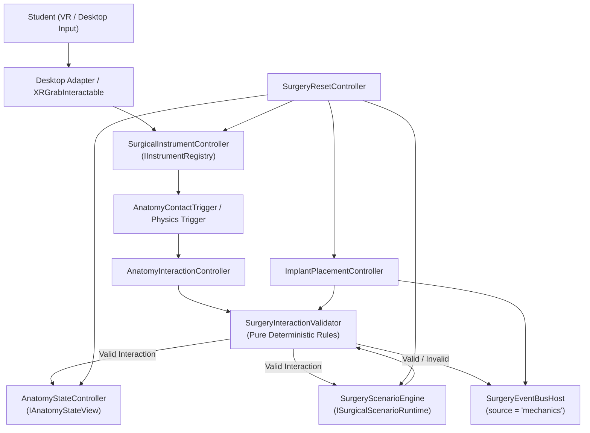

# MedSim AI — Surgical Mechanics Architecture

## 1. System Overview

The Surgical Mechanics architecture follows a strictly deterministic, event-driven pattern designed to isolate simulation gameplay from the AI supervisor, asset art production, and hardware-specific input layers.

---

## 2. Core Subsystems

### 2.1 SurgeryScenarioEngine
* **Interface:** `ISurgicalScenarioRuntime`
* **Role:** Parses and drives the authored surgical scenario (`OR_TKA_TRAINING_001.json`).
* **Responsibilities:**
  - Maintains the active objective index and completed objectives list.
  - Validates prerequisites (`prerequisites`) before activating any subsequent objective.
  - Emits `objective.started` upon activation.
  - Emits `objective.completed` when all conditions are fulfilled.
  - Guarantees `objective.completed(X)` is published at most once per session.

### 2.2 SurgicalInstrumentController
* **Interface:** `IInstrumentRegistry`
* **Role:** Tracks all instruments in the operative scene (`SurgeryInstrumentTag`).
* **Responsibilities:**
  - Manages instrument holder states: `OnTable`, `Player`, `Assistant`, `OnPatient`, `Missing`.
  - Captures grabbing, releasing, and active power states (e.g. oscillating saw vibration).
  - Emits `tool.grabbed`, `tool.released`, `tool.activated`.
  - Resets tools cleanly to `ANCHOR_InstrumentSlot_<id>` on session reset.

### 2.3 SurgeryInteractionValidator
* **Role:** Pure static evaluation engine enforcing scenario rules.
* **Responsibilities:**
  - Validates surgical side: verifies operative site matches patient's right knee (`knee_r.*`).
  - Validates tool requirement: verifies held tool is in `objective.requiredTools`.
  - Validates target region: verifies target is in `objective.targets`.
  - Validates power state: verifies saws and drills are powered on prior to tissue resection.
  - Validates implant positioning: verifies distance error (in mm) and orientation error (in deg) against scenario tolerances (`toleranceMm`, `toleranceDeg`).

### 2.4 AnatomyInteractionController & AnatomyStateController
* **Interface:** `IAnatomyStateView`
* **Role:** Executes virtual anatomy state changes.
* **Responsibilities:**
  - Connects physics triggers between tool tips (`SurgeryInstrumentTag.tip`) and anatomy colliders (`SurgeryAnatomyTag`).
  - Swaps visual meshes and material states across the standard TKA lifecycle:
    `intact` → `marked` → `incised` → `exposed` → `guide_placed` → `resected` → `trial_fitted` → `implanted` → `closed`.
  - On rejection, emits `interaction.rejected` and **guarantees no state changes occur**.

### 2.5 ImplantPlacementController
* **Role:** Controls seating and alignment checks for trial and permanent implant components.
* **Responsibilities:**
  - Measures Euclidean distance ($mm$) and quaternion angle ($^\circ$) between component pose and authored target anchor (`PlacementTarget_<implantId>`).
  - Emits `implant.placement_attempted` with measured errors.
  - Snaps component to position on success and emits `implant.placement_completed`.
  - Rejects placement on out-of-tolerance error (`RejectReasons.OutOfTolerance`).

### 2.6 SurgicalRobotController
* **Role:** Educational robot arm controller (`robot.arm`).
* **Responsibilities:**
  - Anchors base at `ANCHOR_RobotBase`.
  - Monitors virtual workspace limits and safe trajectory bounds.
  - Emits `tool.activated` with `toolId = "robot.arm"`.

### 2.7 SurgeryResetController
* **Role:** Restores simulation to pristine start without scene reloads.
* **Responsibilities:**
  - Subscribes to `session.reset` from the event bus.
  - Restores all anatomy targets to `intact`.
  - Returns instruments to table slots.
  - Clears placed implants.
  - Resets scenario engine to objective 1.

---

## 3. Event Ordering Guarantees (Contract §7.3)

1. `objective.started(X)` is published before any gameplay event tagged with `objectiveId = X`.
2. `objective.completed(X)` is published at most once per session and only after all qualifying interactions have occurred.
3. A rejected attempt publishes `interaction.rejected` and leaves anatomy states untouched.
4. On `session.reset`, all targets return to `intact` and instruments return to slots before the subsequent `objective.started`.
