# MedSim AI — Surgical Interaction & Controls Guide

## 1. Desktop Mode Interaction Controls

The Desktop Mode interaction adapter (`SurgicalDesktopInteractionAdapter`) allows developers, educators, and students to operate the entire simulation using standard mouse and keyboard controls.

| Input | Action | Description |
|---|---|---|
| **W, A, S, D** | Locomotion | Walk forward, left, backward, right around the OR table. |
| **Mouse Move** | Head Look | Rotate camera view to inspect the surgical field. |
| **Left Click** | Pick Up / Apply | Point crosshair at instrument/implant to pick up. While holding an instrument, left-click on an anatomy target to apply the tool. |
| **Scroll Wheel** | Depth Adjustment | Push tool further into the field or pull it closer (0.35m – 1.2m range). |
| **Right Click + Drag**| Tool Rotation | Rotate held instrument pitch and yaw for precision angle alignment. |
| **E** | Power Tool Toggle | Power on / off active tools (e.g. Oscillating Saw, Surgical Drill). |
| **Q** | Drop / Release | Release currently held tool or attempt implant placement. |
| **R** | Session Reset | Instantly resets anatomy states, table slots, and objectives. |

---

## 2. VR Mode Controls (VIVE Focus 3 / OpenXR)

The VR interaction system uses the project's standard OpenXR controller configuration and Unity XR Interaction Toolkit 3.7.0.

| Control | Function | Description |
|---|---|---|
| **Primary Hand Grip** | Grab / Hold | Grip button grabs instrument from table slot or assistant hand-over. |
| **Primary Hand Trigger**| Activate / Interact | Squeeze trigger to activate power tools or perform cutting/stapling action. |
| **Controller Pose** | Spatial Manipulation | Full 6-DoF position and rotation tracking with physical grip anchors. |
| **Haptic Pulses** | Tactical Feedback | - Grab: light pulse (0.25 amp, 50ms) - Resection/Saw: sustained buzz (0.50 amp) - Rejection: sharp warning vibration (0.90 amp, 200ms) - Snap Seating: firm confirmation pulse (0.70 amp, 150ms). |
| **Left Thumbstick** | Smooth / Teleport Locomotion | Move around the operating room while maintaining sterile perimeter. |
| **Right Thumbstick** | Snap / Smooth Turning | Re-orient view relative to the patient's right knee. |

---

## 3. Authored TKA Surgical Workflow (Scenario `OR_TKA_TRAINING_001`)

```mermaid
flowchart LR
    O1["1. Site Confirmation\n(Skin Marker)"] --> O2["2. Skin Incision\n(Scalpel)"]
    O2 --> O3["3. Joint Exposure\n(Retractor)"]
    O3 --> O4["4. Femoral Resection\n(Guide + Saw)"]
    O4 --> O5["5. Tibial Resection\n(Guide + Saw)"]
    O5 --> O6["6. Trial Reduction\n(Femoral & Tibial Trials)"]
    O6 --> O7["7. Femoral Implant\n(Component + Impactor)"]
    O7 --> O8["8. Tibial Implant\n(Tray + Poly Insert)"]
    O8 --> O9["9. Wound Closure\n(Needle Driver / Stapler)"]
```

### Stage Details

1. **`obj.site_confirmation` (Confirm Operative Site)**
   * **Target:** `knee_r.site_marking` (Right Knee)
   * **Required Tool:** `inst.skin_marker`
   * **Result:** Confirms correct patient side before any incision. State transitions to `marked`.
   * **Safety Rule:** Applying tool to wrong knee triggers `RejectReasons.WrongSide`.

2. **`obj.incision` (Skin Incision)**
   * **Target:** `knee_r.incision_line`
   * **Required Tool:** `inst.scalpel`
   * **Result:** Linear anterior incision across front of knee. State transitions to `incised`.

3. **`obj.exposure` (Expose the Joint)**
   * **Target:** `knee_r.joint_capsule`
   * **Required Tool:** `inst.retractor`
   * **Result:** Retracts soft tissues to visualize joint surfaces. State transitions to `exposed`.

4. **`obj.femoral_resection` (Distal Femoral Cut)**
   * **Target:** `knee_r.distal_femur`
   * **Required Tools:** `inst.cutting_guide_femoral`, then powered `inst.oscillating_saw`
   * **Result:** Resects damaged femoral cartilage. State transitions to `resected`.
   * **Safety Rule:** Operating saw while inactive triggers `RejectReasons.ToolNotActive`.

5. **`obj.tibial_resection` (Proximal Tibial Cut)**
   * **Target:** `knee_r.proximal_tibia`
   * **Required Tools:** `inst.cutting_guide_tibial`, then powered `inst.oscillating_saw`
   * **Result:** Creates flat tibial plateau base. State transitions to `resected`.

6. **`obj.trial_reduction` (Component Trial Fitting)**
   * **Targets:** `knee_r.distal_femur`, `knee_r.proximal_tibia`
   * **Components:** `implant.femoral_trial`, `implant.tibial_trial`
   * **Tolerance:** $4\,\text{mm}$ position, $4^\circ$ orientation.
   * **Result:** Checks joint range of motion and stability. State transitions to `trial_fitted`.

7. **`obj.implant_femoral` (Femoral Component Seating)**
   * **Target:** `knee_r.distal_femur`
   * **Component:** `implant.femoral_component`
   * **Required Tools:** `inst.impactor`, `inst.mallet`
   * **Tolerance:** $2\,\text{mm}$ position, $3^\circ$ orientation.
   * **Result:** Permanently seats metal femoral component. State transitions to `implanted`.

8. **`obj.implant_tibial` (Tibial Tray & Poly Insert)**
   * **Target:** `knee_r.proximal_tibia`
   * **Components:** `implant.tibial_tray`, `implant.poly_insert`
   * **Required Tools:** `inst.impactor`, `inst.mallet`
   * **Tolerance:** $2\,\text{mm}$ position, $3^\circ$ orientation.
   * **Result:** Seats tibial tray and inserts polyethylene spacer. State transitions to `implanted`.

9. **`obj.closure` (Wound Closure)**
   * **Target:** `knee_r.wound`
   * **Required Tools:** `inst.needle_driver` or `inst.skin_stapler`
   * **Result:** Closes surgical site. State transitions to `closed`. Session completes.
